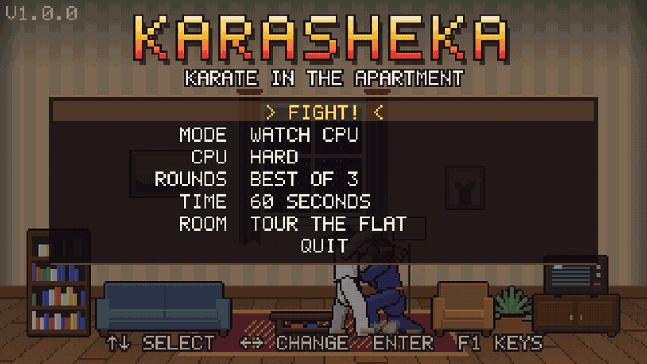

# Karasheka



A retro 2D karate game written in C++17 with SDL2. Two karateka fight it out
in an apartment: the living room, the kitchen, the bedroom and the study.
The floor is flat, but the furniture is fair game. Jump onto a chair, the
table or the fridge to get out of the way, then dive kick down on your
opponent. The higher you dive from, the harder it hits. Light furniture
breaks under a heavy landing.

Each fighter is played with nine keys laid out like a numeric keypad, plus
a strike key: 9 directions times 2 gives 18 actions, in the spirit of the
one-button joystick karate games of the 1980s.

The whole game is drawn at 320 x 180 in crisp pixels and scaled up to the
window. Every fighter, room and piece of furniture is drawn by code, and every
sound (including the shouts) is synthesized, so the game ships with no asset
files.

A sharper 720p version of the clip above is in
[docs/gameplay.mp4](docs/gameplay.mp4).

## How to play

Three key layouts are available. Each player picks one in the menu; a single
player can use any of them.

| Layout | Directions | Strike |
| --- | --- | --- |
| Left hand | `Q W E` / `A S D` / `Z X C` | Left Shift (or Left Ctrl) |
| Right hand | `Y U I` / `H J K` / `N M ,` | Space (or Right Shift) |
| Numpad | `7 8 9` / `4 5 6` / `1 2 3` | Num 0 (or Num Enter) |

The numpad uses Num 0 rather than Shift because Windows turns Shift + numpad
keys into arrow keys.

Holding two keys combines them, so 4 + 8 works like 7. Moving and jumping go
the way the key points on screen. Attacks are relative to your opponent:
"forward" is toward them, "back" is away. The tables below are for the
fighter on the left; for the fighter on the right, they mirror.

**On their own:**

| | | |
| --- | --- | --- |
| 7 jump back | 8 jump up | 9 jump forward |
| 4 walk back | 5 guard | 6 walk forward |
| 1 roll back | 2 crouch | 3 roll forward |

**With the strike key held** (or strike alone for the punch):

| | | |
| --- | --- | --- |
| 7 backflip kick | 8 uppercut | 9 flying kick |
| 4 roundhouse | 5 punch | 6 front kick |
| 1 low punch | 2 low kick | 3 sweep |

**In the air:** strike is an air kick, and down + strike is a dive kick.

You can press the direction and the strike key in either order. A strike
pressed a moment before you are free to act (during a landing, say) still
comes out.

| Key | Action |
| --- | --- |
| Esc | Pause (resume, show the keys, or quit to the menu) |
| F1 | Show or hide the keys (pauses the fight while open) |
| F2 | Sound on / off |
| F11 or Alt+Enter | Toggle fullscreen |

### The menu

The menu runs a computer fight in the background. Use the arrow keys to pick
a line and change it:

* **Mode:** 1 player (against the computer), 2 players on one keyboard, or
  watch two computers fight.
* **CPU:** Easy, Normal or Hard.
* **Keys:** the layout for each human player.
* **Rounds:** 1 round, best of 3 or best of 5.
* **Time:** 30, 60 or 99 seconds a round, or no limit.
* **Room:** tour the flat (a new room every round) or stay in one room.

Your choices are saved in `settings.ini` in the per-user folder SDL picks
(on Windows, `%APPDATA%\Karasheka\Karasheka\`).

## Rules

* Each fighter starts a round with 100 health. A round ends with a knockout,
  or when time runs out (the fighter with more health left wins). A double
  knockout or a tie gives both fighters the round.
* **Guard (5)** blocks everything except low attacks. **Crouching (2)**
  blocks everything except overheads: air attacks, and any attack from a
  fighter standing a good bit higher than you, such as on a table. An attack
  from below at a fighter standing on furniture counts as low. You can't
  guard in the air or with your back to the attacker.
* High attacks (the roundhouse and the uppercut) pass over a crouching
  fighter. The sweep and the low kick go under a jump.
* Some hits knock you down. So does any hit in the air. You're invulnerable
  while you're down and while you get up.
* A roll passes under high attacks and through your opponent, so you come
  up on the other side.

### Moves

Frames are 1/60 s: how long a move takes to come out (startup), how long it
can hit (active), and how long you're stuck afterwards (recovery).

| Move | Keys | Startup / active / recovery | Damage | Guard with | Notes |
| --- | --- | --- | --- | --- | --- |
| Punch | strike (or 5 + strike) | 5 / 3 / 9 | 6 | either | Fast reverse punch. |
| Front kick | forward + strike | 8 / 4 / 13 | 9 | either | Good reach. |
| Roundhouse | back + strike | 12 / 4 / 18 | 14 | either | Head height, steps in, knocks down. |
| Uppercut | 8 + strike | 6 / 5 / 16 | 11 | either | Anti-air, knocks down. |
| Low punch | down-back + strike | 4 / 3 / 8 | 5 | either | Quick poke from a crouch. |
| Low kick | 2 + strike | 6 / 3 / 11 | 7 | crouch | Fast, low. |
| Sweep | down-forward + strike | 10 / 5 / 20 | 10 | crouch | Knocks down. |
| Flying kick | up-forward + strike | 7 / until landing | 12 | guard | Leaps forward, knocks down. |
| Backflip kick | up-back + strike | 4 / 8 | 9 | either | Kicks up while flipping away. |
| Air kick | strike in the air | 4 / until landing | 9 | guard | |
| Dive kick | down + strike in the air | 3 / until landing | 10 to 24 | guard | Steep dive. Damage grows with height, knocks down. |

### Furniture

Every piece of furniture is a platform you land on from above. You walk in
front of it, jump onto it, and walk off its edge to drop down. A standing
jump rises about 44 pixels (a fighter is about 50 tall), enough for a table
or a counter. To reach the top of the fridge, the wardrobe or a bookshelf,
jump from something lower next to it.

Chairs, stools, the tables, the nightstand, the desk, the TV and the monitor
break after a few heavy landings: a fighter knocked down onto them, or a
dive kick that lands on them. Whatever stands on a piece goes down with it.
Each round starts with the room as new.

| Room | Furniture |
| --- | --- |
| Living room | bookshelf, sofa, coffee table, armchair, TV cabinet with a TV on it |
| Kitchen | fridge, counter, a table with two chairs, a stool |
| Bedroom | wardrobe, bed, nightstand, dresser, chair |
| Study | two bookshelves, a desk with a monitor, an office chair, a filing cabinet |

### Computer opponents

A computer player uses the same nine keys and strike key as you do. It sees
you a few frames late (20 frames on Easy, 12 on Normal, 7 on Hard) and decides
from that what to do:

* It guards or ducks attacks it sees coming, using the right guard for each.
* It meets jump-ins with an uppercut.
* It punishes moves that miss.
* It picks attacks by range and by what you're doing. It sweeps a standing
  guard and jumps in on someone crouching.
* It climbs onto furniture and waits for you to wander into diving range.

The levels differ in reaction time, how often they guard, how often they
attack, and how well they judge range.

## How it works

* **One skeleton for everything.** A fighter is a stick figure with joint
  angles (`src/core/pose.cpp`). The same skeleton draws the fighter, places
  its hurt boxes (head, torso, thighs, shins) and puts the strike point on
  the fist or foot. A kick hits exactly where the foot is drawn, and ducking
  works because the crouching body is actually lower. Moves blend between
  chamber, strike and recovery poses.
* **Pixel art from shapes.** Limbs are thick capsules with a dark outline and
  three-tone shading, rasterized without anti-aliasing into a 320 x 180
  frame (`src/gfx/art.cpp`). The rooms (wallpaper, windows, perspective
  floors) and the furniture sprites are drawn the same way. The frame is
  blown up by a whole number with no filtering, then filtered down to the
  window, so pixels stay crisp at any window size.
* **Deterministic.** The fight runs in fixed 1/60 s ticks with its own
  seeded random generator and no SDL, so the tests and the recording tool
  play whole matches headlessly.

## Building

You need CMake 3.16+, a C++17 compiler and SDL2 (2.0.10 or newer). If CMake
cannot find SDL2, it downloads and builds it automatically. Turn that off with
`-DKARA_FETCH_SDL=OFF`.

**Windows (Visual Studio + vcpkg):**

```sh
cmake -S . -B build -DCMAKE_TOOLCHAIN_FILE=%VCPKG_ROOT%/scripts/buildsystems/vcpkg.cmake
cmake --build build --config Release
build\Release\karasheka.exe
```

`vcpkg.json` makes vcpkg install SDL2 automatically. `SDL2.dll` is copied next
to the executable, and the procedurally drawn icon is embedded in the `.exe`.

**Linux:**

```sh
sudo apt install build-essential cmake libsdl2-dev   # or your distro's equivalent
cmake -S . -B build -DCMAKE_BUILD_TYPE=Release
cmake --build build -j
./build/karasheka
```

**macOS:**

```sh
brew install cmake sdl2
cmake -S . -B build -DCMAKE_BUILD_TYPE=Release
cmake --build build -j
./build/karasheka
```

The game has been built and tested on Windows only. The Linux and macOS steps
use only SDL2 and the standard library, but have not been tried yet.

### Windows release and itch.io

`tools/release_windows.sh` builds a self-contained release: SDL2 and the C++
runtime are linked statically (vcpkg triplet `x64-windows-static`), so players
need no DLLs or Visual C++ redistributable. It runs the tests, checks the
`.exe` imports only system DLLs, stages `dist/karasheka-<version>-windows/`
(the game, a player readme, licenses and an `.itch.toml` launch manifest) and
zips it. Given an itch.io project, it also uploads the folder to the
`windows` channel with [butler](https://itch.io/docs/butler/):

```sh
tools/release_windows.sh                       # build, test and package only
butler login                                   # once
tools/release_windows.sh your-name/karasheka   # ... and upload
```

The version comes from `project(Karasheka VERSION ...)` in `CMakeLists.txt`
and is shown on the menu.

## Tests

`kara_tests` checks the game without opening a window:

* The controls map every key and chord to the right move, mirrored for the
  fighter on the right.
* The skeleton stands on the floor at about 50 pixels tall, lies flat when
  knocked down, and crouches below the roundhouse.
* Hits and guards: a punch hits, and a guard blocks it. A guard does not stop
  a sweep, but crouching does. Crouching ducks a roundhouse and blocks a
  front kick. An air kick beats a crouching guard. A roll passes through the
  opponent.
* Furniture: a jump lands on the kitchen table and walking off its edge
  drops to the floor. A dive kick from the table hits harder than one from
  a floor jump. A fighter knocked down onto the stool breaks it and falls
  through to the floor.
* Whole computer matches (Hard vs Hard, Easy vs Easy, Hard vs Normal) all
  finish, and the computers land a variety of moves and use the furniture.
  Each pairing prints statistics such as moves tried and landed, blocks,
  furniture landings, time in the air and knockouts. The same seed always
  plays the same match, and Hard beats Easy.

```sh
ctest --test-dir build -C Release
build/Release/kara_tests 20                 # play 20 matches per pairing instead of 6
build/Release/kara_tests probe 12345 40     # health after 40 s of a Hard vs Hard fight
```

## Command-line options

```
--size WxH             window (or capture) size (default 1280x720)
--screenshot FILE.bmp  play a CPU fight offscreen, save one frame and exit
--scene NAME           menu | intro | fight | ko | over | help | pause | cover |
                       poses (every pose on one sheet, for tuning the skeleton)
--time SECONDS         fight time before a fight / cover capture (default 8)
--seed N               match seed (captures default to 12345; --record defaults to
                       the best of 120 auditioned seeds)
--record FILE|-        play the showcase clip, writing raw RGB24 frames
--fps N                frame rate for --record (default 30)
```

Captures are drawn in software, so they need no window or graphics driver.

### Regenerating the clip, the cover and the screenshot

`tools/make_media.sh` makes `docs/gameplay.mp4` (1280 x 720, 30 fps),
`docs/gameplay.gif` (640 px wide, 15 fps, exactly 2x the game's pixels),
`docs/cover.png` (1280 x 640, the size GitHub uses for a repository's
social preview) and `docs/screenshot.png`. You need bash and ffmpeg with
libx264.

```sh
tools/make_media.sh                      # uses build/Release/karasheka or build/karasheka
tools/make_media.sh path/to/karasheka
```

For the clip, the game first plays the opening 32 seconds of 120 candidate
seeds headlessly. It keeps the seed with the most going on: a dive kick, a
piece of furniture breaking, a flying kick, a sweep, a landing on furniture
and a knockout. Matches are deterministic, so the recording replays exactly
what was auditioned.

## Layout

```
src/core/   skeleton and poses, moves and fight rules, rooms and furniture, computer players (no SDL)
src/gfx/    software framebuffer, 5x7 pixel font, procedural art, anti-aliased canvas for the icon (no SDL)
src/app/    SDL2 game: menus, input layouts, effects, rendering, synthesized audio, settings
tools/      icongen (app icon as a Windows .ico at build time), make_media.sh (clip, cover, screenshot),
            release_windows.sh and release/ (Windows package and itch.io upload)
tests/      headless tests
docs/       gameplay.mp4, gameplay.gif, cover.png, screenshot.png
```
